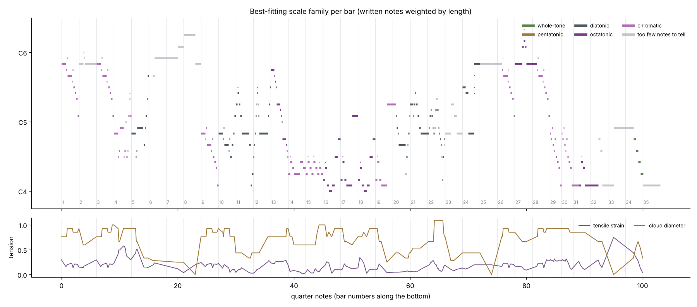

# Syrinx, bar by bar: a first data map for the visual score

A research note. It runs the study guide's unit 6 method on the actual score in this repository
(`public/music/claude-debussy-syrinx/score.musicxml`, a MuseScore export, 35 bars) to get a first, data-driven draft of
where Syrinx's colours change. The point is not to replace your hearing; it is to give you something concrete to agree
or disagree with before deciding where the visual score's "worlds" change.

Reproduce it (needs librosa's environment plus partitura for the tension lane):

```bash
cd docs/research/study-guide-scripts
.venv/bin/pip install partitura
.venv/bin/python scale_map.py ../../../public/music/claude-debussy-syrinx/score.musicxml --tension --plot ../figures/syrinx-scale-worlds.png
```



## Before you read on

Mark on your own copy of Syrinx where *you* hear the colour change, and give each stretch a one-word name. Do it now,
before the table below shapes what you hear. Then compare.

## What was measured

- **Best-fitting scale family per bar.** For every bar, the share of written time that falls on each whole-tone,
  pentatonic, diatonic, octatonic scale, preferring the smallest family that covers at least 85%; otherwise
  "chromatic". Bars with fewer than four different pitch classes are marked "too few to tell". Code:
  `study-guide-scripts/unit6_scale_worlds.py` (`best_scale`), `scale_map.py`.
- **Tonal tension per bar** (Herremans and Chew's tension ribbons, computed by partitura's `estimate_tonaltension` over
  a two-beat window): *cloud diameter* (how spread out the recent notes are in tonal space) and *tensile strain* (how
  far their centre is from the key). See `reading-list.md`, unit 6.
- **Debussy's written directions**, read from the score.

## The numbers, grouped by Debussy's own markings

| Bars | Marking | Best fit (per bar) | Tension | What the data shows |
|---|---|---|---|---|
| 1 to 4 | Très modéré | chromatic (9 pitch classes in bars 1 and 3) | diameter high (0.85 to 0.89) | The opening motive: a chromatic descent from B♭5, stated twice, then answered lower in bar 4. |
| 5 to 8 | Retenu at 8 | diatonic in bar 5, then long held high notes | diameter falls 0.54 to 0.12 | The line settles onto long notes (A♭5, B5, C♯6, E♭6): too few pitch classes to name a scale, and tension drains away. |
| 9 to 12 | Un peu mouvementé (mais très peu) | bar 9 chromatic, then diatonic {C♯ E♭ F F♯ A♭ B♭ B/C} | strain lowest of the first half (0.07 to 0.13) | The motive an octave lower (bar 9 matches bars 1 and 3), then arabesques inside D♭ major / B♭ minor, the home key. |
| 13 to 19 | Cédez at 15, Rubato at 16 | octatonic and chromatic; bars 14 and 15 use only 4 pitch classes yet fit no scale | diameter high again (0.69 to 0.89) | The low, circling middle: a chromatic cluster (E♭4 to F♯4) and octatonic turns around C4 to A4. |
| 20 to 25 | (trille) at 23 and 24 | diatonic {C♯ E♭ F F♯ A♭ B♭ B/C} | strain lowest of the piece (0.06 to 0.07 in bars 20 and 21) | Back in the home key, rising toward the held B♭5 of bar 25. |
| 26 to 30 | au Mouvᵗ (très modéré), dim. at 28 | chromatic, identical to bars 1 and 3 | diameter highest of the piece in bars 29 and 30 (0.91 to 0.93) | The opening motive returns, then twice more an octave lower (bars 29 and 30, like bar 9). |
| 31 to 35 | En retenant jusqu'à la fin; Très retenu, perdendosi at 34 | octatonic at 31, then **whole-tone {C♯ E♭ F G A B}** at 34 | (bar 33 is one note; its strain value is not meaningful) | The ending descends through a whole-tone scale. |

## Observations worth checking against your hearing

1. **The data finds the form without being told.** The opening motive gives identical numbers wherever it appears
   (bars 1, 3, 26, 28 high; bars 9, 29, 30 low). A visual score could give that motive one recurring visual idea and
   let its register (high or low statement) change its scale.
2. **Debussy's markings fall where the data changes.** "Un peu mouvementé" (9) starts the move into the home-key
   arabesques; "Cédez" and "Rubato" (15, 16) sit in the octatonic and chromatic middle; "au Mouvᵗ" (26) is the
   return; "En retenant" (31) begins the move to the whole-tone ending. These are natural places for the visual world
   to change.
3. **Tension and scale family tell different stories.** The home-key arabesques (10 to 12, 20 and 21) have low strain:
   they sit close to the key. The motive statements and the middle have high cloud diameter: their notes spread across
   tonal space. Tension could drive a continuous quality (brightness, turbulence) while the scale family drives
   discrete changes (which "world" the pond is in).
4. **The whole-tone ending is clear; whole-tone elsewhere is not.** If you hear whole-tone colour earlier, for
   example in the opening, this measure will not show it: bars 1 to 4 come out chromatic, partly because the motive's
   quick 32nd-note turns (A5 and B5 around B♭5) add notes outside any whole-tone set. Weighting notes only by written length may be the wrong choice for a line where
   long notes carry the colour and short ones decorate it. Try weighting by length squared, or ignoring notes shorter
   than a sixteenth, and see whether the opening changes.

## Limits of this measure

- It counts **written** notes and lengths. It does not hear phrasing, implied harmony, or which notes are passing.
- **Per-bar windows cut phrases** that cross bar lines. The two-bar view in the script's output is steadier and shows
  different boundaries; neither is "right".
- **"Octatonic" may be an artifact.** The octatonic set contains many chromatic fragments, so a busy chromatic bar can
  fit it at 85% by accident. Treat octatonic labels as "chromatic, but organised" until you have checked the notes.
- The file spells some notes enharmonically (C♯ for D♭, F♯ for G♭). Pitch classes are unaffected; spelling-aware tools
  (partitura's key estimate) can be.
- **Bar 33 is a single note**, so its tension value comes from almost nothing.

## A first draft of the visual score's worlds (to argue with)

Only after you have made your own map:

| World | Bars | Why |
|---|---|---|
| Motive, high | 1 to 4, 26 to 28 | identical chromatic statements |
| Settling | 5 to 8, 25 | long held notes, tension draining |
| Motive, low | 9, 29, 30 | the same motive an octave down |
| Home key | 10 to 12, 20 to 24 | diatonic, lowest strain |
| The low middle | 13 to 19 | chromatic cluster and octatonic turns, Cédez and Rubato |
| Whole-tone ending | 31 to 35 | octatonic into whole-tone, En retenant jusqu'à la fin |

Where your map and this one disagree, write down why. Those reasons are the musical knowledge a program does not have,
and they are what makes the visual score yours.

## Follow-up: finding the boundaries directly

The per-bar table above uses fixed windows, which blur boundaries. `study-guide-scripts/segment_worlds.py` instead
splits the whole melody into stretches that each fit one scale, choosing the split with dynamic programming (cost =
time not explained by each stretch's best scale, plus a penalty for every new stretch). It also tests the open
question from observation 4: does the colour change if short decorative notes count for less?

```bash
.venv/bin/python segment_worlds.py ../../../public/music/claude-debussy-syrinx/score.musicxml --penalty 2
.venv/bin/python segment_worlds.py ../../../public/music/claude-debussy-syrinx/score.musicxml --penalty 0.5 --weight long-only
```

**Coarse (penalty 2), three weightings.** All three found four worlds with nearly the same boundaries:

| Weighting | Worlds (bars) |
|---|---|
| by written length | 1 to 11 chromatic, 11 to 19 chromatic, 19 to 25 diatonic (D♭ major / B♭ minor), 26 to 35 chromatic |
| length squared | 1 to 11 diatonic, 12 to 19 chromatic, 19 to 28 pentatonic {C♯ E♭ F♯ A♭ B♭}, 28 to 35 pentatonic {C♯ E F♯ A B} |
| only notes of a sixteenth or longer | 1 to 11 diatonic, 12 to 19 chromatic, 19 to 26 diatonic, 26 to 35 chromatic |

**Fine (penalty 0.5).** Six worlds, and the whole-tone ending appears on its own under both weightings tried:

| Weighting | Worlds (bars) |
|---|---|
| by written length | 1 to 5 chromatic, 5 to 12 diatonic, 13 to 19 chromatic, 19 to 22 diatonic, 22 to 31 chromatic, **31 to 35 whole-tone** |
| only notes of a sixteenth or longer | 1 to 11 diatonic, 12 to 14 diatonic {C D E♭ F G A B♭}, 14 to 19 chromatic, 19 to 26 diatonic, 26 to 31 chromatic, **31 to 35 whole-tone** |

What this adds:

1. **The boundaries are robust; the labels are not.** Around bar 11 or 12, bar 19, bar 25 or 26 and bar 31 appear
   whatever the weighting. The labels change with it. A visual score can trust the boundaries and treat the labels as
   a choice.
2. **The opening's long notes live in the home key.** Counting only notes of a sixteenth or longer turns bars 1 to 11
   from chromatic to D♭ major / B♭ minor (97%). The chromatic colour comes from the quick notes. That is a real musical
   claim to test with your ear: is the opening "chromatic with a home underneath", or "home with chromatic
   decoration"?
3. **The whole-tone ending starts exactly at "En retenant jusqu'à la fin" (bar 31)** when worlds are allowed to be
   short. With a coarser penalty it is absorbed into the larger return section, which is itself a useful lesson: the
   penalty decides how many worlds you get, so choose it for the visuals you want, not as a fact about the piece.
